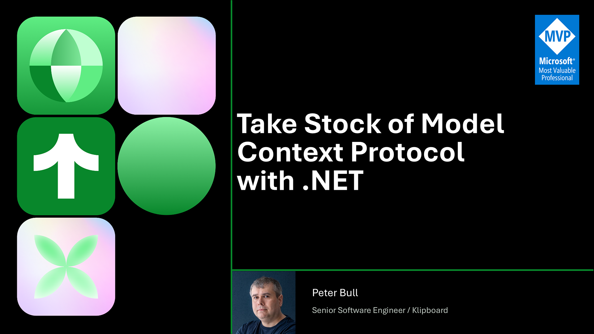

# Take Stock of Model Context Protocol with .NET

## Presentation

Here you can find Slides, Demo and Links for my presentation **Take Stock of Model Context Protocol with .NET**



## Demo

Open this repository folder in **Visual Studio Code***. The root `.mcp.json` configures the
`Stock` server at `http://localhost:5054/mcp`.

Start the server from a terminal at the repository root:

```
dotnet run --project .\Demo\Stock.Mcp\Stock.Mcp\Stock.Mcp.csproj --launch-profile http
```

Run **MCP: List Servers** in VS Code, select **Stock**, and start the connection.
Trust the workspace/server if prompted. In Copilot Chat, type `/Stock.` to select
a prompt, for example `/Stock.stock_assistant` or `/Stock.setup_demo`.

See the [Demo README](Demo/Stock.Mcp/Stock.Mcp/README.md) for prompt arguments
and troubleshooting.

## Links

* [klipboard.com](https://klipboard.com)
* [comentsys.com](https://comentsys.com)
* [rogueplanetoid.com](https://rogueplanetoid.com)
* [tutorialr.com](https://tutorialr.com)
* [github.com/rogueplanetoid](https://github.com/rogueplanetoid)
* [linkedin.com/in/rogueplanetoid](https://linkedin.com/in/rogueplanetoid)
* [modelcontextprotocol.io](https://modelcontextprotocol.io)
* [dot.net](https://dot.net)
* [gh.io/copilot](https://gh.io/copilot)
* [code.visualstudio.com](https://code.visualstudio.com)
* [github.com/rogueplanetoid/takestockofmcpwithdotnet](https://github.com/rogueplanetoid/takestockofmcpwithdotnet)